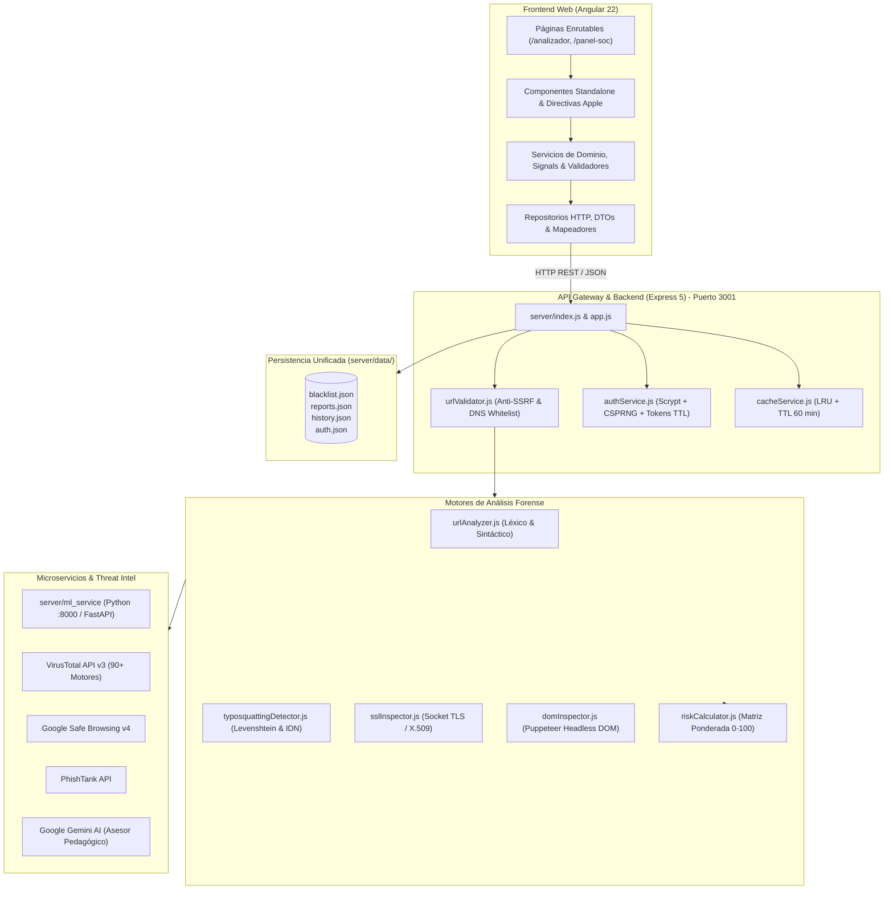
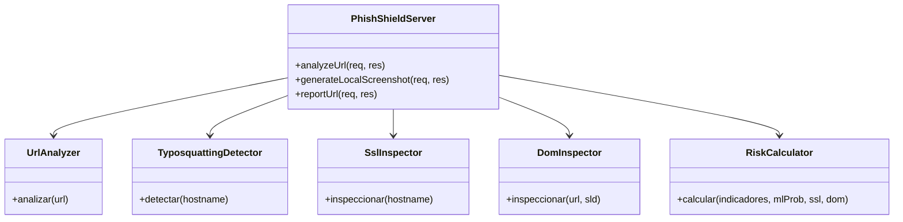
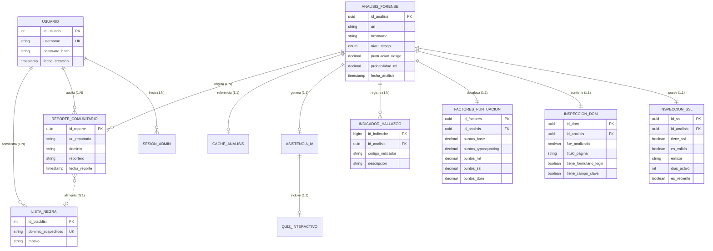

# 🎓 Documento de Sustentación de Grado: PhishShield
## Plataforma Integral de Detección Forense de Phishing, Análisis Multicapa e Inteligencia de Amenazas

---

### 📌 Información del Proyecto de Grado
* **Título del Proyecto:** PhishShield – Plataforma Defensiva de Análisis Forense Automatizado de URLs, Detección de Suplantación de Identidad y Mitigación de Phishing con Inteligencia Artificial.
* **Programa Académico:** Ingeniería de Software / Ciencias de la Computación.
* **Autor / Expositor:** Wilson Camilo Rios (Wilcam1).
* **Año Académico:** 2026.
* **Repositorio Oficial:** [GitHub - Wilcam1/Phishshield-Angular](https://github.com/Wilcam1/Phishshield-Angular)

---

## 📑 Tabla de Contenidos
1. [Resumen Ejecutivo y Planteamiento del Problema](#1-resumen-ejecutivo-y-planteamiento-del-problema)
2. [Objetivos del Proyecto](#2-objetivos-del-proyecto)
3. [Arquitectura del Software (Clean Architecture & Desacoplamiento)](#3-arquitectura-del-software-clean-architecture--desacoplamiento)
4. [El Motor Forense Multicapa (Los 19 Factores de Inspección)](#4-el-motor-forense-multicapa-los-19-factores-de-inspección)
5. [Microservicio de Machine Learning e Inteligencia Artificial Generativa](#5-microservicio-de-machine-learning-e-inteligencia-artificial-generativa)
6. [Ingeniería de Frontend y Experiencia de Usuario (Apple Design & Signals)](#6-ingeniería-de-frontend-y-experiencia-de-usuario-apple-design--signals)
7. [Seguridad Perimetral, Criptografía y Persistencia](#7-seguridad-perimetral-criptografía-y-persistencia)
8. [Arquitectura de Datos y Modelo Relacional (3FN)](#8-arquitectura-de-datos-y-modelo-relacional-3fn)
9. [Guion de Exposición Paso a Paso (Presentación ante el Jurado)](#9-guion-de-exposición-paso-a-paso-presentación-ante-el-jurado)
10. [Ronda de Preguntas Típicas del Jurado y Respuestas de Alto Nivel](#10-ronda-de-preguntas-típicas-del-jurado-y-respuestas-de-alto-nivel)
11. [Conclusiones e Impacto Profesional](#11-conclusiones-e-impacto-profesional)

---

## 1. Resumen Ejecutivo y Planteamiento del Problema

### 1.1 Contexto de la Amenaza
El phishing representa más del **85% de los incidentes iniciales de ciberseguridad** en organizaciones y usuarios particulares a nivel mundial (según reportes de ENISA, CISA y APWG). Las técnicas de engaño han evolucionado drásticamente:
* **Uso generalizado de certificados TLS legítimos:** Los atacantes aprovechan entidades gratuitas (*Let's Encrypt*, *ZeroSSL*) para mostrar el "candado verde" en el navegador, desarmando la confianza del usuario.
* **Ataques de Homógrafos IDN y Typosquatting:** Registro de dominios con alfabetos cirílicos o griegos idénticos a nivel visual (`раураl.com` mediante Punycode `xn--...`).
* **Páginas dinámicas efímeras en SPAs:** Sitios maliciosos construidos con React o Angular que cargan formularios de credenciales de forma asíncrona tras evadir rastreadores básicos.
* **Campañas dirigidas al sector bancario:** Suplantación de portales de autenticación financiera local e internacional (Bancolombia, Davivienda, BBVA, PayPal, etc.).

### 1.2 La Brecha en las Soluciones Actuales
* Las listas negras tradicionales (DNS blacklists) son **reactivas**: una campaña maliciosa causa estragos durante horas antes de que la URL sea catalogada.
* Los escáneres comunes no realizan una **inspección profunda de renderizado DOM en sandbox**, perdiendo elementos ocultos o JavaScript malicioso.
* Falta de componentes pedagógicos que expliquen al usuario **por qué** un enlace es peligroso.

### 1.3 Solución Aportada: PhishShield
PhishShield aborda esta problemática mediante una **arquitectura híbrida defensiva**:
Combina **19 factores de análisis heurístico**, **inspección criptográfica X.509**, **renderizado dinámico Headless con Chromium**, **inferencia probabilística por Machine Learning supervisado** y **generación de explicaciones pedagógicas con Modelos de Lenguaje Grande (LLM - Gemini AI)**.

---

## 2. Objetivos del Proyecto

### 2.1 Objetivo General
Diseñar, implementar y evaluar una plataforma integral de detección forense de phishing y análisis preventivo de URLs, fundamentada en principios de arquitectura limpia, microservicios resilientes, modelos de Machine Learning y una interfaz física de alta fidelidad.

### 2.2 Objetivos Específicos
1. **Construir un API Gateway defensivo en Node.js (Express 5)** con protecciones contra ataques SSRF, cabeceras seguras (OWASP) y control de flujo mediante rate limiting.
2. **Implementar un motor de inspección multicapa** que evalúe simultáneamente métricas léxicas, distancias de edición Levenshtein, detección de homoglifos Punycode, atributos TLS/SSL y análisis del árbol DOM mediante Puppeteer.
3. **Desarrollar y entrenar un microservicio de Machine Learning en Python** basado en algoritmos de clasificación supervisada y cálculo de la **Entropía de Shannon**, con mecanismo de conmutación por fallo (*graceful degradation*).
4. **Desarrollar un cliente web en Angular 22** desacoplado en 4 capas estrictas con reactividad basada en **Signals**, Standalone Components y patrones de diseño físico **Apple Design**.
5. **Garantizar la persistencia y despliegue continuo** mediante Docker multi-stage y volumen unificado para datos forenses e históricos.

---

## 3. Arquitectura del Software (Clean Architecture & Desacoplamiento)

### 3.1 Diagrama de Topología del Sistema

### 3.2 Aislamiento Estricto de Capas en Frontend (ESLint Enforced)
El código en `src/app/` respeta una separación forzada en tiempo de compilación por la regla `no-restricted-imports` de ESLint:

1. **Capa de Presentación (`src/app/presentacion/`):**
   * *Responsabilidad:* Renderizado visual, microinteracciones, animaciones de resorte.
   * *Restricción:* **Prohibido** importar de `datos/repositorios/`, `datos/dto/` o `@angular/common/http`. Solo consume señales y servicios de `logica/` y modelos puros.
2. **Capa de Lógica (`src/app/logica/`):**
   * *Responsabilidad:* Reglas de negocio, orquestación, estados reactivos con `signal()` y `computed()`, validadores de 4 factores, guardias de ruta e interceptores.
   * *Restricción:* Jamás importa de la capa de presentación.
3. **Capa de Datos (`src/app/datos/`):**
   * *Responsabilidad:* Contratos DTO, mapeadores puros (`analisis.mapeador.ts`), repositorios HTTP (`analisis.repositorio.ts`) y almacenamiento local seguro.
   * *Restricción:* Es la base; no depende de ninguna otra capa de la aplicación.

---

## 4. El Motor Forense Multicapa (Los 19 Factores de Inspección)

PhishShield no se fía de un único indicador. Evalúa 19 vectores de ataque divididos en 5 subsistemas especializados:

### 4.1 Análisis Léxico y Sintáctico (`urlAnalyzer.js`)
* **Detección de direcciones IP:** Bloqueo de URLs que omiten nombres de dominio legítimos (ej. `http://192.168.0.5/login`).
* **Caracteres de ofuscación:** Búsqueda del carácter `@` (utilizado para engañar navegadores ocultando el destino real) y doble barra invertida `//` en la ruta.
* **Profundidad de subdominios:** Alerta cuando un dominio cuenta con más de 3 niveles de anidación (ej. `banco.seguridad.verificacion.login-cliente.com`).
* **Longitud excesiva:** Detección de cadenas que superan los 75 caracteres para dificultar la inspección en dispositivos móviles.
* **Extensiones de riesgo binario:** Detección de descargas forzadas (`.exe`, `.scr`, `.bat`, `.apk`, `.zip`).
* **TLDs sospechosos de bajo coste:** Alerta ante terminaciones como `.xyz`, `.top`, `.tk`, `.ml`, `.ga`.

### 4.2 Detector de Typosquatting y Homógrafos (`typosquattingDetector.js`)
* **Ataques de Homógrafos IDN (Punycode):** Decodificación de cadenas `xn--`. Detecta si se sustituyeron letras del alfabeto latino por glifos idénticos del cirílico o griego.
* **Distancia de Levenshtein:** Compara el *Second Level Domain* (SLD) contra un diccionario de marcas financieras (Bancolombia, Davivienda, BBVA, PayPal, Apple, etc.). Si la distancia de edición es 1 o 2 (ej. `banc0lombia` o `paypa1`), se activa la alerta de suplantación de identidad.
* **Palabras clave de engaño:** Identificación de combinaciones léxicas como `-login`, `secure-`, `verify-`, `account-`, `banking-`.
* **Cotejo contra Lista Negra Local:** Consulta instantánea contra `server/data/blacklist.json`.

### 4.3 Inspección Criptográfica TLS/SSL (`sslInspector.js`)
* Handshake TLS nativo mediante `tls.connect` sobre el puerto 443.
* **Antigüedad del Certificado:** Alerta crítica si el certificado tiene **menos de 15 días de expedición** (típico de sitios de phishing desechables).
* **Certificados Autofirmados:** Detección inmediata cuando el emisor (*Issuer*) es idéntico al sujeto (*Subject*).
* **Caducidad e Inconsistencia:** Certificados vencidos o emitidos para dominios con comodines (*Wildcard*) que no coinciden con el destino.

### 4.4 Renderizado DOM en Modo Sandbox (`domInspector.js`)
* Ejecución headless aislada con **Puppeteer**.
* **Detección de formularios sensibles:** Búsqueda de campos `<input type="password">`, entradas de número de tarjeta o CVV en dominios no autorizados.
* **Detección de trampas de evasión:** Identificación de redirecciones automáticas (`<meta http-equiv="refresh">`) e `iframes` de pantalla completa utilizados para ocultar el phishing dentro de un sitio legítimo comprometido.

### 4.5 Ponderador de Riesgo Matricial (`riskCalculator.js`)
Consolida los hallazgos en una escala continua de 0 a 100:
* **Bajo (0 - 24):** Tráfico legítimo con certificado válido y sin patrones de engaño.
* **Medio (25 - 49):** Anomalías leves (TLD sospechoso o certificado muy nuevo).
* **Alto (50 - 74):** Múltiples factores concurrentes (ej. formulario de contraseña en dominio no oficial).
* **Crítico (75 - 100):** Confirmado por listas de amenazas o suplantación directa de identidad bancaria.
* **Regla de Piso Crítico (*Score Floor*):** Si la URL está en la lista comunitaria o es detectada por VirusTotal / Safe Browsing, la puntuación se fija automáticamente en un mínimo de **90 puntos**.

---

## 5. Microservicio de Machine Learning e Inteligencia Artificial Generativa

### 5.1 Microservicio en Python (`server/ml_service/`)
Un microservicio desacoplado basado en **FastAPI y Uvicorn** expuesto en el puerto `8000`:
* **Extractor de Características (`extractor.py`):** Convierte la URL en un vector matemático de 16 variables numéricas.
* **Entropía de Shannon:** Cuantifica la aleatoriedad en los caracteres del dominio:
  $$\mathcal{H}(S) = -\sum_{i=1}^{k} P(c_i) \log_2 P(c_i)$$
  Los dominios generados por algoritmos maliciosos (DGA) o campañas de spam masivo exhiben valores de entropía notablemente superiores a los de dominios corporativos.
* **Modelo Scikit-Learn (`model.joblib`):** Clasificador supervisado que retorna la probabilidad continua de phishing ($0.0 \le p \le 1.0$).
* **Resiliencia y Degradación Elegante (*Graceful Fallback*):** Si el microservicio Python se detiene, el servidor Node.js captura el evento de fallo (`ECONNREFUSED`), loguea la contingencia y continúa el análisis con los otros 18 motores sin interrumpir el servicio al usuario.

### 5.2 IA Generativa Pedagógica (`aiExplanationService.js`)
Integración con **Google Gemini AI**:
* Genera un **resumen pedagógico en lenguaje natural** adaptado a usuarios no técnicos, explicando exactamente por qué la URL representa una amenaza.
* Crea dinámicamente un **Quiz interactivo de ciberseguridad** con preguntas de opción múltiple para fomentar la cultura de prevención y alfabetización digital en la organización.

---

## 6. Ingeniería de Frontend y Experiencia de Usuario (Apple Design & Signals)

### 6.1 Reactividad Nativa con Angular Signals
En lugar de depender de suscripciones complejas de RxJS en las plantillas HTML o incurrir en fugas de memoria, el frontend utiliza el paradigma reactivo moderno de Angular:
* `signal()`: Para estados mutables locales (`estaAnalizando`, `urlCapturaEfectiva`, `segundosEsperando`).
* `computed()`: Para derivar valores computados reactivos con renderizado óptimo y bajo costo computacional.
* `inject()`: Inyección funcional de dependencias eliminando constructores sobrecargados.

### 6.2 Principios de Diseño Físico Apple Design
* **Glassmorphism / Superficies Translúcidas:** Tarjetas con efecto de cristal esmerilado continuo (`backdrop-filter: blur(20px) saturate(180%)`).
* **Física de Resortes Críticamente Amortiguados:** Curvas de transición modeladas mediante `cubic-bezier(0.16, 1, 0.3, 1)` para respuestas táctiles inmediatas y sin rebotes molestos.
* **Directivas de Microinteracción Háptica:**
  * `inclinacion-3d.directiva.ts`: Efecto de perspectiva y profundidad reactivo al movimiento del cursor (*3D Tilt*).
  * `luz-cursor.directiva.ts`: Resplandor radial dinámico que sigue el puntero sobre los paneles.
  * `magnetico.directiva.ts`: Atracción magnética sutil en botones de acción.
* **Accesibilidad (a11y):** Respeto riguroso de `@media (prefers-reduced-motion: reduce)` y contrastes de color WCAG AAA.

### 6.3 Motor de Captura Headless con Hidratación SPA (`/api/screenshot`)
Para mostrar una vista previa visual segura del sitio malicioso sin exponer al analista a descargas involuntarias:
* Se ejecuta Puppeteer en modo sandbox.
* **Pausa de 3 segundos (3000 ms):** Tras el evento `domcontentloaded`, el backend aguarda 3 segundos. Esto garantiza que las aplicaciones de página única (SPAs) completen el renderizado de scripts y remuevan los *spinners* o pantallas de carga, logrando una captura fiel de la página real.
* **Optimización JPEG:** Compresión de imagen con calidad al 75% y almacenamiento en caché LRU en memoria (reducción del peso de ~3 MB a ~60 KB).

---

## 7. Seguridad Perimetral, Criptografía y Persistencia

### 7.1 Defensa contra SSRF (Server-Side Request Forgery)
El módulo `server/security/urlValidator.js` valida minuciosamente cada URL antes de permitir cualquier conexión de red o lanzamiento de Chromium:
* Resuelve el nombre de host mediante DNS.
* Bloquea direcciones IP de loopback (`127.0.0.1`, `localhost`, `::1`).
* Bloquea segmentos privados RFC 1918 (`10.0.0.0/8`, `172.16.0.0/12`, `192.168.0.0/16`).
* Bloquea la dirección de enlace local de metadatos de computación en la nube (`169.254.169.254` en AWS/GCP/Azure).

### 7.2 Módulo Criptográfico de Autenticación (`authService.js`)
* **Derivación de claves con Scrypt:** Sal criptográfica aleatoria de 16 bytes generada con CSPRNG y clave derivada de 64 bytes (`sal:hash`).
* **Protección contra Ataques de Canal Lateral (*Timing Attacks*):** La comparación de hashes se ejecuta en tiempo constante mediante `crypto.timingSafeEqual`.
* **Tokens de Sesión Criptográficos:** Generación de tokens de 256 bits (`psh_[hex64]`) con expiración forzada por TTL de 2 horas.

### 7.3 Persistencia y Despliegue en Producción
* **Directorio Unificado `server/data/`:** Todos los almacenes de datos residen en esta ruta.
* **Aislamiento en Git (`.gitignore`):** Los archivos de sesión y transaccionales dinámicos (`history.json`, `cache.json`, `auth.json`) se ignoran en el control de versiones, mientras que las listas base (`blacklist.json`, `reports.json`) se versionan limpiamente.
* **Persistencia en Docker:** El volumen `phishshield-data` se mapea sobre `/app/server/data`, garantizando cero pérdida de auditorías y reportes ante reinicios del contenedor.
* **Script Universal de Automatización (`iniciar.bat`):** Permite el arranque en paralelo de toda la plataforma en Windows con doble clic, detectando automáticamente entornos virtuales de Python.

---

## 8. Arquitectura de Datos y Modelo Relacional (3FN)

Aunque el motor utiliza persistencia documental en JSON por ligereza en Docker, el diseño lógico se encuentra **completamente normalizado en Tercera Forma Normal (3FN)**:

---

## 9. Guion de Exposición Paso a Paso (Presentación ante el Jurado)

> **Tiempo Estimado de la Exposición:** 15 a 20 minutos + 10 minutos de preguntas.

### ⏱️ Fase 1: Introducción y Justificación (Minutos 0 a 3)
* **Apertura:** *"Buenos días/tardes a los miembros del honorable jurado evaluador. Mi nombre es Wilson Camilo Rios y hoy presento el proyecto PhishShield: Plataforma Integral de Detección Forense de Phishing, Análisis Multicapa e Inteligencia de Amenazas."*
* **Problema:** Explicar que el 85% de las brechas de datos inician con un correo o enlace malicioso y que el 70% del phishing actual cuenta con certificado SSL válido, engañando a los usuarios comunes.
* **Propuesta de Valor:** PhishShield ofrece una solución holística: inspección forense en 19 factores, IA explicativa y una experiencia de usuario fluida y transparente.

### ⏱️ Fase 2: Arquitectura del Sistema e Innovación Técnica (Minutos 3 a 7)
* **Clean Architecture en Frontend:** Mostrar el diagrama de capas de Angular 22 (`nucleo`, `datos`, `logica`, `presentacion`) y cómo ESLint previene dependencias prohibidas.
* **Paradigma Reactivo:** Explicar el uso de **Signals** (`signal()`, `computed()`) para un rendimiento superior frente a RxJS clásico.
* **Diseño Apple:** Destacar los tokens de diseño, superficies translúcidas (*glassmorphism*) y física de resortes.
* **Backend y Microservicios:** Explicar el API Gateway en Node.js Express 5 y su articulación con el microservicio en Python para Machine Learning y la API de Gemini para la pedagogía interactiva.

### ⏱️ Fase 3: Demostración en Vivo (Demo Práctica) (Minutos 7 a 13)
* **Caso 1: Dominio Legítimo Seguro**
  * Probar `https://www.bancolombia.com`.
  * Mostrar cómo el sistema verifica el certificado SSL de larga vigencia, emisor oficial, ausencia de typosquatting y asigna riesgo **Bajo** con veredicto verde.
* **Caso 2: Ataque de Typosquatting / Suplantación Bancaria**
  * Probar un dominio sospechoso como `https://banc0lombia-seguridad-login.xyz`.
  * Observar en tiempo real:
    * Detección por **Levenshtein** del SLD imitado (*Bancolombia*).
    * Alerta por TLD de riesgo (`.xyz`).
    * Inferencia del microservicio de Machine Learning por **Entropía de Shannon** alta.
    * Captura de pantalla headless tomada con espera de 3 segundos mostrando el diseño del sitio falso.
    * Puntuación asignada: **Riesgo Crítico / Alto**.
* **Caso 3: Panel SOC y Gestión de Incidentes**
  * Iniciar sesión en `/panel-soc` con credenciales de administrador.
  * Mostrar las métricas globales, el catálogo de reportes comunitarios y la exportación de incidentes a formato CSV.
* **Caso 4: Pedagogía con IA y Quiz Interactivo**
  * Mostrar el resumen explicativo generado por Google Gemini y responder la pregunta del quiz interactivo generado en caliente.

### ⏱️ Fase 4: Pruebas de Calidad y Conclusiones (Minutos 13 a 16)
* Mostrar el paso exitoso de las pruebas automatizadas:
  * Backend: 37 pruebas pasando en Vitest.
  * Frontend: Pruebas unitarias de mapeadores, servicios y validadores.
  * Linter: 0 errores arquitectónicos.
* Cierre formal y agradecimientos.

---

## 10. Ronda de Preguntas Típicas del Jurado y Respuestas de Alto Nivel

### ❓ Pregunta 1: *"¿Por qué utilizaron una arquitectura desacoplada con Python para Machine Learning en vez de ejecutar TensorFlow.js directamente en Node.js?"*
> **Respuesta del Estudiante:**
> *"Optamos por un microservicio independiente en Python debido al ecosistema maduro de ciencia de datos (Scikit-Learn, NumPy, FastAPI) y por principios de escalabilidad. Al desacoplar el modelo en un proceso satélite en el puerto 8000, prevenimos que el cálculo intensivo de la Entropía de Shannon y la inferencia bloqueen el Event Loop de Node.js. Además, diseñamos un patrón de 'Graceful Fallback': si el contenedor de Python experimenta una falla, el API Gateway captura el fallo sin interrumpir el escaneo de los otros 18 motores heurísticos."*

### ❓ Pregunta 2: *"¿Cómo mitigan el riesgo de que el propio servidor de PhishShield sea utilizado para atacar la red interna mediante SSRF?"*
> **Respuesta del Estudiante:**
> *"Implementamos una capa de validación perimetral en `server/security/urlValidator.js`. Antes de que cualquier servicio o Chromium intente establecer una conexión, resolvemos el host a nivel DNS y cotejamos la dirección IP contra una lista negra estricta de direcciones de loopback (127.0.0.1, ::1), los tres rangos privados de la RFC 1918 (10.0.0.0/8, 172.16.0.0/12, 192.168.0.0/16) y la IP de metadatos de proveedores cloud (169.254.169.254). Si la URL intenta resolver hacia cualquiera de estos destinos, la solicitud se rechaza con código 400 y alerta de seguridad."*

### ❓ Pregunta 3: *"¿Qué ventaja técnica ofrece Angular Signals sobre los tradicionales Observables de RxJS en este proyecto?"*
> **Respuesta del Estudiante:**
> *"Angular Signals introduce reactividad de grano fino sin necesidad de intervención manual del ciclo de detección de cambios (Zone.js). En PhishShield, el estado del análisis se modela mediante señales atómicas (`estaAnalizando`, `resultadoActual`). Esto elimina por completo el riesgo de fugas de memoria por suscripciones huérfanas en componentes, simplifica el código al no requerir pipes asíncronos (`| async`) repetitivos y asegura que únicamente se re-renderice en el DOM el fragmento exacto que sufrió la mutación."*

### ❓ Pregunta 4: *"¿Por qué se introdujo un retardo de 3 segundos en la captura de pantalla de Puppeteer?"*
> **Respuesta del Estudiante:**
> *"Las páginas web modernas y las campañas de phishing sofisticadas están construidas como Single Page Applications (SPAs). Si la captura se ejecuta inmediatamente al dispararse el evento `domcontentloaded`, el navegador captura únicamente una pantalla blanca o un spinner de carga (`loading`). Los 3 segundos permiten que los scripts dinámicos se hidraten, completen las peticiones asíncronas iniciales y pinten la interfaz real de suplantación, entregando al analista forense una evidencia gráfica fidedigna."*

### ❓ Pregunta 5: *"¿Por qué persistir en archivos JSON si diseñaron un modelo relacional en 3FN?"*
> **Respuesta del Estudiante:**
> *"El almacenamiento en JSON bajo `server/data/` responde a un requerimiento de portabilidad y despliegue rápido ('zero-dependency installation') en entornos de demostración y contenedores Docker livianos. Sin embargo, toda la lógica de negocio y las interfaces del dominio en TypeScript respetan la Tercera Forma Normal (3FN), lo que permite que una migración futura hacia PostgreSQL o MySQL requiera únicamente sustituir la implementación de los repositorios sin alterar una sola línea de código en la capa de lógica ni de presentación."*

---

## 11. Conclusiones e Impacto Profesional

1. **Rigor en la Ingeniería de Software:** PhishShield demuestra que la seguridad y el rendimiento no son accidentales, sino el resultado de aplicar patrones sólidos de diseño: Clean Architecture, inyección de dependencias, tipado estricto e inmutabilidad.
2. **Capacidad Defensiva Real:** La combinación de inspección criptográfica, heurísticas léxicas, renderizado DOM y Machine Learning logra mitigar ataques de última generación que eluden los filtros tradicionales.
3. **Usabilidad y Empatía Tecnológica:** Mediante los lineamientos de Apple Design y la pedagogía generativa de Gemini AI, el sistema no solo bloquea amenazas, sino que capacita activamente al ser humano, cerrando la brecha más crítica en ciberseguridad: el error humano.
