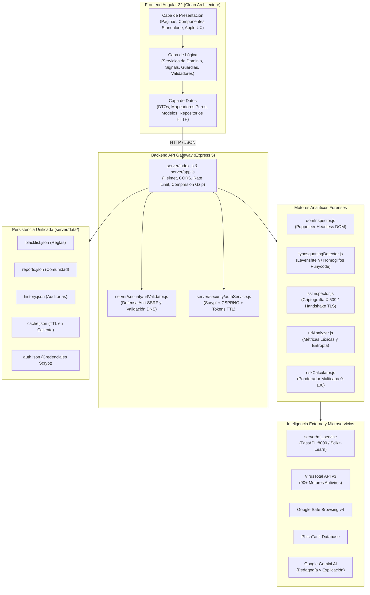

# 🛡️ PhishShield - Plataforma Integral de Detección Forense de Phishing

PhishShield es un ecosistema defensivo de ciberseguridad diseñado para la inspección forense automatizada, clasificación y neutralización de URLs maliciosas y campañas de suplantación de identidad (*phishing*). 

Combina un frontend reactivo desarrollado en **Angular 22** bajo principios de **Clean Architecture** y estética **Apple Design**, un **API Gateway & Backend modular en Node.js (Express 5)** con 19 factores de análisis heurístico, y un microservicio satélite de **Machine Learning en Python (Scikit-Learn)** para evaluación inferencial probabilística.

---

## 🏛️ 1. Arquitectura General del Sistema

El sistema implementa una arquitectura desacoplada por capas con inversión de control, inyección de dependencias y aislamiento estricto de responsabilidades:



---

## 🔄 2. Ciclo de Vida y Flujo Forense End-to-End

Cuando un analista o usuario somete una URL sospechosa a través de la aplicación:

1. **Captura y Validación Reactiva (Frontend):**
   * El usuario ingresa la URL en `BarraBusquedaComponente`.
   * El validador reactivo [`url.validador.ts`](file:///c:/Users/Wilson%20Rios/Documents/Proyectos/PhishShield%20-%20Angular/src/app/logica/validadores/url.validador.ts) comprueba sintaxis, protocolo y formato RFC 3986 en tiempo real.
   * `AnalisisServicio` activa el estado reactivo (`estaAnalizando = signal(true)`).
   * `AnalisisRepositorio` despacha una petición `POST /analizar` mediante `HttpClient`.
2. **Defensa Perimetral WAF & Anti-SSRF (Backend):**
   * `server/security/urlValidator.js` intercepta la petición.
   * Resuelve el destino DNS y bloquea cualquier intento de evasión hacia `localhost`, interfaces `127.0.0.1/8`, rangos privados RFC 1918 (`10.0.0.0/8`, `172.16.0.0/12`, `192.168.0.0/16`), IPv6 de loopback (`::1`) o metadatos de computación en la nube (`169.254.169.254`).
3. **Caché en Caliente:**
   * `AnalysisCache` comprueba si la URL ya fue analizada dentro de su ventana TTL (60 min). Si existe, retorna el veredicto instantáneamente sin penalizar cuotas de red.
4. **Ejecución Concurrente Multicapa:**
   * **Análisis Léxico:** `urlAnalyzer.js` calcula longitud, ratio de dígitos, subdominios profundos y caracteres sospechosos (`@`, `//`, `%20`).
   * **Typosquatting & Homoglifos:** `typosquattingDetector.js` decodifica Punycode (`xn--`), detecta alfabetos cirílicos/griegos y calcula la distancia de Levenshtein contra marcas reconocidas (`bancolombia`, `paypal`, `google`, etc.) y la lista de firmas en `server/data/blacklist.json`.
   * **Inspección Criptográfica TLS/SSL:** `sslInspector.js` inicia un socket TLS nativo, verifica validez X.509, entidad certificadora (detectando emisores sospechosos o autofirmados), días transcurridos y fechas de caducidad.
   * **Inspección DOM Headless:** `domInspector.js` lanza una instancia ligera de Chromium con Puppeteer para extraer formularios clandestinos, campos `<input type="password">`, frames ocultos y scripts de suplantación.
   * **Inferencia Machine Learning:** `mlService.js` consulta el microservicio FastAPI (`:8000`). Si el microservicio no está disponible, activa un fallback suave sin interrumpir la auditoría.
   * **Threat Intelligence Global:** Consultas paralelas no bloqueantes a VirusTotal, Google Safe Browsing y PhishTank.
   * **Explicación Pedagógica IA:** `aiExplanationService.js` genera recomendaciones en lenguaje natural utilizando el modelo Google Gemini.
5. **Cálculo Ponderado de Riesgo:**
   * `riskCalculator.js` consolida los 19 factores en una puntuación de 0 a 100, asignando el nivel forense: **Bajo**, **Medio**, **Alto** o **Crítico**.
6. **Persistencia & Captura Visual:**
   * El resultado se almacena en el registro FIFO de `server/data/history.json`.
   * El visor de presentación solicita `GET /api/screenshot?url=...`. Puppeteer renderiza la página esperando **3 segundos** para permitir la hidratación de frameworks modernos (Angular, React, Vue) y evitar capturar pantallas con logos de carga (*spinners*).

---

## 💻 3. Módulos del Frontend (Angular 22)

El frontend está estructurado bajo **Clean Architecture** con nomenclatura homogénea en español y convenciones de sufijos de archivo (`.servicio.ts`, `.componente.ts`, `.modelo.ts`, etc.):

```text
src/app/
├── nucleo/                          # Capa transversal de configuración
│   ├── constantes/                  # Parámetros globales y claves del sistema
│   └── entornos/                    # Variables de entorno y URLs de backend
│
├── datos/                           # Capa de Acceso a Datos y Contratos
│   ├── dto/                         # Contratos de red (DTO) con formato de API
│   ├── modelos/                     # Modelos puros de dominio (fuertemente tipados)
│   ├── mapeadores/                  # Transformadores puros DTO <-> Modelo
│   ├── repositorios/                # Único punto de consumo de HttpClient y APIs
│   └── fuentes/                     # Almacenamiento local (localStorage) protegido
│
├── logica/                          # Capa de Dominio y Orquestación
│   ├── estado/                      # Gestión de estado reactivo mediante Signals
│   ├── servicios/                   # Servicios de orquestación y lógica de negocio
│   ├── guardias/                    # Guardias de ruta funcionales (CanActivateFn)
│   ├── interceptores/               # Interceptores HTTP funcionales para Bearer tokens
│   └── validadores/                 # Validadores reactivos desacoplados
│
└── presentacion/                    # Capa de Presentación (Solo UI y UX)
    ├── paginas/                     # Vistas enrutables con Lazy Loading
    ├── componentes/                 # Componentes Standalone delgados
    ├── directivas/                  # Microinteracciones físicas estilo Apple Design
    ├── tuberias/                    # Pipes puras para transformación de formatos
    ├── diseno/                      # Sistema de diseño, tokens SCSS y variables CSS
    └── rutas/                       # Configuración declarativa de rutas
```

### 3.1 Detalle de Módulos del Frontend

#### Capa Núcleo (`src/app/nucleo/`)
* **`configuracion.constante.ts`**: Define umbrales de riesgo, duraciones de animación, claves de almacenamiento en sesión y límites de paginación.
* **`entorno.ts`**: Contiene la configuración de despliegue (`apiUrl: 'http://localhost:3000'`, flags de depuración).

#### Capa de Datos (`src/app/datos/`)
* **`analisis.dto.ts` y `administracion.dto.ts`**: Interfaces TypeScript que modelan las respuestas del servidor. Aisladas para absorber cualquier cambio en los contratos de la API sin afectar la interfaz de usuario.
* **`analisis.modelo.ts` y `administracion.modelo.ts`**: Entidades de dominio puras que utiliza la lógica de la aplicación.
* **`analisis.mapeador.ts`**: Funciones puras que transforman las respuestas crudas de la API (`AnalisisRespuestaDto`) en modelos inmutables de dominio (`ResultadoAnalisis`).
* **`analisis.repositorio.ts`**: Abstrae las llamadas HTTP REST (`POST /analizar`, `POST /reportar`, `GET /estadisticas`, `GET /historial`). Implementa operadores reactivos de RxJS (`map`, `catchError`).
* **`almacenamiento-local.fuente.ts`**: Fachada segura sobre `window.localStorage` con serialización JSON tolerante a excepciones.

#### Capa de Lógica (`src/app/logica/`)
* **`sesion.estado.ts`**: Administra el estado global de autenticación del panel SOC mediante señales (`signal()`, `computed()`), asegurando persistencia entre recargas y cierre de sesión seguro.
* **`tema.estado.ts`**: Control reactivo del modo oscuro / claro con persistencia y sincronización con las preferencias del sistema operativo (`prefers-color-scheme`).
* **`analisis.servicio.ts`**: Orquesta el caso de uso principal de análisis de URLs. Expone señales de solo lectura (`estaAnalizando`, `resultadoActual`, `errorAnalisis`) para que los componentes consuman el estado sin mutarlo directamente.
* **`motor-consejos.servicio.ts`**: Motor heurístico en el cliente que analiza los factores de riesgo identificados y genera recomendaciones de seguridad claras y accionables para el usuario.
* **`notificacion.servicio.ts`**: Cola reactiva de alertas y notificaciones flotantes (*toasts*) con auto-descarte y soporte para mensajes de éxito, advertencia y error.
* **`autenticacion.guardia.ts`**: Guardia funcional `CanActivateFn` que restringe el acceso al `/panel-soc` a usuarios con tokens de sesión válidos.
* **`autenticacion.interceptor.ts`**: Interceptor HTTP funcional que inyecta automáticamente la cabecera `Authorization: Bearer <token>` en las rutas administrativas protegidas.
* **`url.validador.ts` y `contrasena.validador.ts`**: Validadores puros de fortaleza de contraseñas de 4 factores (mayúsculas, minúsculas, números, caracteres especiales) y formato de URLs.

#### Capa de Presentación (`src/app/presentacion/`)
* **Páginas Enrutables (`paginas/`)**:
  * **`analizador.pagina.ts`**: Vista principal de escaneo con barra de búsqueda rápida, visualización de métricas en vivo, medidor de aguja de riesgo, tarjeta de veredicto detallada, visor de captura visual y acordeón de factores técnicos.
  * **`panel-soc.pagina.ts`**: Centro de Operaciones de Seguridad (SOC) con KPIs agregados, telemetría de motores externos, tabla global interactiva de incidentes con búsqueda y drawer lateral de inspección forense.
  * **`arquitectura.pagina.ts`**: Visualizador interactivo 3D con Three.js que renderiza la topología del sistema y el flujo de capas en tiempo real.
* **Componentes Standalone (`componentes/`)**: Componentes delgados sin lógica de negocio directa (`barra-busqueda`, `tarjeta-veredicto`, `medidor-riesgo`, `visor-captura`, `lista-consejos`, `panel-metricas`, `telemetria-servicios`, `selector-tema`, `drawer-incidente`).
* **Directivas Físicas Apple (`directivas/`)**:
  * `inclinacion-3d.directiva.ts`: Efecto de perspectiva y profundidad reactivo al movimiento del ratón (*tilt effect*).
  * `luz-cursor.directiva.ts`: Resplandor radial dinámico que sigue el cursor sobre superficies de cristal esmerilado (*glassmorphism*).
  * `magnetico.directiva.ts`: Efecto magnético que atrae botones interactivos suavemente hacia el cursor.
  * `aparecer-al-desplazar.directiva.ts`: Animaciones basadas en `IntersectionObserver`.
* **Tuberías Puras (`tuberias/`)**: Formateadores de fecha relativa, colores de badges según nivel de riesgo (`riesgo-color`), porcentajes y sanitización de markdown seguro.

### 3.2 Forzado de Fronteras de Arquitectura con ESLint

Para garantizar que ningún desarrollador rompa la separación de capas, [`eslint.config.cjs`](file:///c:/Users/Wilson%20Rios/Documents/Proyectos/PhishShield%20-%20Angular/eslint.config.cjs#L36-L109) aplica la regla `no-restricted-imports` en tiempo de compilación:

| Capa | Puede Importar de: | Prohibido Importar de: |
| :--- | :--- | :--- |
| **Presentación** | `logica/`, `datos/modelos/` | `datos/repositorios/`, `datos/dto/`, `@angular/common/http` |
| **Lógica** | `datos/`, Angular Core/RxJS | `presentacion/` |
| **Datos** | Angular Core/RxJS, DTOs | `logica/`, `presentacion/` |

---

## ⚙️ 4. Módulos del Backend (Node.js & Express 5)

El backend está diseñado como una solución modular centrada en una clase principal [`PhishShieldServer`](file:///c:/Users/Wilson%20Rios/Documents/Proyectos/PhishShield%20-%20Angular/server/app.js) con **inyección de dependencias**, lo que permite mockear cualquier subsistema durante pruebas automatizadas:

```text
server/
├── analyzers/                       # Motores de Análisis Forense
│   ├── urlAnalyzer.js               # Análisis léxico, sintáctico y de estructura de URL
│   ├── typosquattingDetector.js     # Detección de homógrafos, Levenshtein y listas negras
│   ├── sslInspector.js              # Handshake TLS/SSL, análisis de certificados X.509
│   ├── domInspector.js              # Inspección DOM con Puppeteer (inputs, iframes, formularios)
│   └── riskCalculator.js            # Ponderación heurística matricial (Score 0 a 100)
│
├── security/                        # Módulos de Protección y Criptografía
│   ├── urlValidator.js              # Validador Anti-SSRF y filtro de rangos IP privados
│   └── authService.js               # Criptografía Scrypt, CSPRNG y gestión de tokens con TTL
│
├── services/                        # Servicios de Integración Externa y Caché
│   ├── virusTotalService.js         # Cliente API VirusTotal v3
│   ├── safeBrowsingService.js       # Cliente API Google Safe Browsing v4
│   ├── phishTankService.js          # Conector de base de datos PhishTank
│   ├── aiExplanationService.js      # Conector Google Gemini AI para asesoría pedagógica
│   ├── cacheService.js              # Caché en memoria con serialización asíncrona a disco
│   └── mlService.js                 # Cliente HTTP resiliente hacia el microservicio Python
│
├── repositories/                    # Abstracción de Persistencia en Disco
│   ├── historyRepository.js         # Repositorio FIFO de historial de auditorías
│   └── reportRepository.js          # Repositorio de dominios reportados por usuarios
│
├── data/                            # Directorio Unificado de Persistencia
│   ├── blacklist.json               # Firmas y dominios sospechosos base
│   ├── reports.json                 # Registro de URLs marcadas como maliciosas
│   ├── history.json                 # Historial en caliente (ignorado en Git)
│   ├── cache.json                   # Caché TTL en caliente (ignorado en Git)
│   └── auth.json                    # Credenciales maestras con sal Scrypt (ignorado en Git)
│
├── tests/                           # Suite de pruebas unitarias y de integración en Vitest
├── app.js                           # Orquestador del servidor Express con DI
└── index.js                         # Entrypoint del servidor y manejo de Graceful Shutdown
```

### 4.1 Detalle de Analizadores Forenses (`server/analyzers/`)

1. **`urlAnalyzer.js`**: Inspecciona las propiedades estructurales de la URL:
   * Detección de direcciones IP directas en lugar de nombres de dominio (ej. `http://192.168.1.1/login`).
   * Detección de caracteres de ofuscación `@` (usados para engañar la barra de navegación del navegador).
   * Conteo de subdominios excesivos (> 3 niveles).
   * Longitud total de URL y longitud del hostname (las URLs de phishing suelen exceder los 75 caracteres).
   * Detección de extensiones de archivo de riesgo ejecutable en la ruta (`.exe`, `.scr`, `.bat`, `.apk`, `.zip`).
   * Detección de TLDs comúnmente asociados a actividades maliciosas gratuitas o no reguladas (`.xyz`, `.top`, `.tk`, `.ml`, `.ga`, `.cf`).
2. **`typosquattingDetector.js`**:
   * **Homógrafos IDN (Punycode):** Detecta dominios que inician con `xn--` o contienen caracteres cirílicos/griegos visualmente idénticos a los caracteres latinos (ej. `раураl.com` donde 'а' y 'р' son cirílicos).
   * **Distancia Levenshtein:** Compara el Second Level Domain (SLD) contra marcas financieras y tecnológicas globales (`bancolombia`, `davivienda`, `bbva`, `paypal`, `netflix`, `google`, `apple`, etc.). Si la distancia de edición es 1 o 2, alerta de posible suplantación.
   * **Palabras Clave de Trampa:** Detecta combinaciones sospechosas en el nombre del dominio como `-login`, `secure-`, `verify-`, `account-`, `banking-`.
   * **Lista Negra Local:** Coteja el dominio contra `server/data/blacklist.json`.
3. **`sslInspector.js`**:
   * Establece una conexión TLS nativa con el servidor remoto para descargar la cadena de certificados X.509.
   * Evalúa si el certificado es autofirmado (`issuer === subject`).
   * Verifica la fecha de expiración y alerta si el certificado está caducado o próximo a vencer.
   * Calcula los días de antigüedad del certificado: certificados con menos de 15 días de expedición elevan el riesgo (típico de sitios de phishing efímeros).
   * Comprueba si el certificado fue emitido para un wildcard (`*.dominio.com`) o un dominio totalmente distinto al consultado.
4. **`domInspector.js`**:
   * Ejecuta Chromium en modo *headless* mediante Puppeteer en un entorno sandbox aislado (`--no-sandbox`).
   * Analiza el árbol DOM renderizado en busca de campos de contraseñas (`input[type="password"]`), formularios de inicio de sesión o recopilación de números de tarjetas de crédito / CVV.
   * Detecta técnicas de evasión como redirecciones instantáneas vía `<meta http-equiv="refresh">` e `iframes` de pantalla completa.
5. **`riskCalculator.js`**:
   * Agrega todos los indicadores forenses recopilados y calcula una puntuación consolidada de 0 a 100 mediante ponderación matricial:
     * **Bajo (0 - 24):** Dominio legítimo verificado con SSL válido y sin patrones de engaño.
     * **Medio (25 - 49):** Anomalías leves (TLD sospechoso o certificado reciente sin suplantación evidente).
     * **Alto (50 - 74):** Múltiples factores concurrentes (ej. formulario de contraseña en dominio no oficial o typosquatting detectado).
     * **Crítico (75 - 100):** Confirmado por VirusTotal / Google Safe Browsing, suplantación directa de identidad bancaria o presencia en lista negra.
   * Aplica la regla de **Piso Crítico (*Score Floor*)**: si el sitio fue reportado manualmente o confirmado por inteligencia de amenazas, la puntuación mínima se eleva forzosamente a 90 puntos.

### 4.2 Motor de Captura Headless de Pantalla (`/api/screenshot`)

Para proveer una vista previa segura del sitio analizado sin exponer al usuario a descargas o exploits del navegador:
* Se ejecuta Puppeteer con bloqueo de descargas pesadas (archivos multimedia y fuentes no esenciales).
* **Hidratación y Renderizado Completo (Espera de 3 Segundos):** Tras dispararse el evento `domcontentloaded`, el motor realiza una pausa de **3000 ms** antes de capturar el viewport. Esto permite que los frameworks modernos (Angular, React, Vue, portales bancarios con SPAs) ejecuten sus scripts, completen la hidratación de componentes y remuevan las pantallas de carga o *spinners*, garantizando una captura visual fiel de la interfaz real del sitio.
* **Optimización JPEG:** La captura se comprime en formato JPEG con calidad al 75%, reduciendo el peso de la imagen de ~3 MB a ~60 KB, almacenándose en una caché LRU en memoria.

---

## 🤖 5. Microservicio de Machine Learning en Python (`server/ml_service/`)

El sistema incluye un microservicio desacoplado para clasificación basada en aprendizaje supervisado:

```text
server/ml_service/
├── main.py                          # API REST basada en FastAPI y Uvicorn (:8000)
├── extractor.py                     # Extractor de vectores numéricos de características
├── model.joblib                     # Modelo preentrenado Scikit-Learn
├── train.py                         # Pipeline reproducible de entrenamiento y validación
└── requirements.txt                 # Dependencias Python (FastAPI, Scikit-learn, Joblib)
```

### 5.1 Extracción de Características Léxicas y Entropía (`extractor.py`)
El extractor transforma la cadena de texto de la URL en un vector matemático de 16 variables:
1. Longitud total de la URL.
2. Longitud del hostname y de la ruta.
3. Conteo de puntos (`.`), guiones (`-`), guiones bajos (`_`), barras (`/`), signos de interrogación (`?`) y signos igual (`=`).
4. Ratio de caracteres numéricos respecto al total de la cadena.
5. **Entropía de Shannon del Dominio:** Mide el grado de aleatoriedad en los caracteres del nombre de dominio:
   $$\mathcal{H}(S) = -\sum_{i=1}^{k} P(c_i) \log_2 P(c_i)$$
   Los dominios generados mediante Algoritmos de Generación de Dominios (DGA) o ataques de phishing presentan una entropía significativamente mayor que los dominios legítimos.
6. Presencia de palabras clave de engaño (`login`, `verify`, `banking`, `secure`, `account`).

### 5.2 Resiliencia y Fallback Transparente
En [`server/services/mlService.js`](file:///c:/Users/Wilson%20Rios/Documents/Proyectos/PhishShield%20-%20Angular/server/services/mlService.js), si el microservicio en Python no se encuentra activo o falla por timeout (1.5 segundos), el API Gateway captura el evento `ECONNREFUSED` y continúa la evaluación de la URL con los 18 motores heurísticos restantes, garantizando **cero tiempo de inactividad** para el usuario.

---

## 🐳 6. Infraestructura y Despliegue con Docker

El proyecto se distribuye listo para producción mediante Docker y Docker Compose:

### 6.1 Multi-stage Dockerfile
* **Stage 1 (Compilación Frontend):** Utiliza `node:20-bookworm-slim` para compilar el cliente Angular generando bundles minificados con tree-shaking en `/app/dist/phishshield-angular`.
* **Stage 2 (Runtime de Producción):**
  * Instala las dependencias del sistema de Chromium y fuentes TrueType (`fonts-liberation`, `ca-certificates`).
  * Configura las variables para Puppeteer (`PUPPETEER_SKIP_CHROMIUM_DOWNLOAD=true`, `PUPPETEER_EXECUTABLE_PATH=/usr/bin/chromium`).
  * Ejecuta bajo el usuario de sistema no privilegiado `node`.
  * Define un `HEALTHCHECK` activo que consulta `/health` cada 30 segundos.

### 6.2 Persistencia con Volúmenes Docker
En [docker-compose.yml](file:///c:/Users/Wilson%20Rios/Documents/Proyectos/PhishShield%20-%20Angular/docker-compose.yml):
* **Servicio `phishshield`**: Expuesto en el puerto `3000:3000`.
* **Servicio `phishshield-ml`**: Expuesto internamente en el puerto `8000:8000`.
* **Volumen `phishshield-data`**: Montado en `/app/server/data`. Almacena de manera persistente en el host el historial de análisis, las listas comunitarias y las credenciales cifradas, asegurando que ningún reinicio o actualización de contenedores destruya los datos.

---

## 🚀 7. Guía de Instalación y Ejecución

### Prerrequisitos
* **Node.js**: `v20.x` o superior
* **NPM**: `v10.x` o superior
* **Python**: `3.10+` *(Opcional, solo si se desea correr el servicio ML en local sin Docker)*

### 1. Clonación del Repositorio
```bash
git clone https://github.com/Wilcam1/Phishshield-Angular.git
cd Phishshield-Angular
npm install
```

### 2. Configurar Variables de Entorno
```bash
cp .env.example .env
```
Configure sus claves de API en `.env` (VirusTotal, Google Safe Browsing, Gemini AI).

### 3. Modos de Ejecución
```bash
# 1. Modo Fullstack Total (ML Python :8000 + API Node :3000 + Frontend Angular :4200)
npm start

# 2. Modo Ligero (API Node :3000 + Frontend Angular :4200, sin necesidad de Python)
npm run start:no-ml

# 3. Solo microservicio Machine Learning
npm run ml

# 4. Solo servidor Backend
npm run server

# 5. Solo cliente Angular
npm run client

# 6. Compilación de Producción
npm run build
```

### 4. Despliegue Inmediato con Docker
```bash
docker-compose up -d --build
```
Acceda a la aplicación en `http://localhost:3000`.

---

## 🧪 8. Pruebas Automatizadas y Calidad

El proyecto mantiene una suite integral de pruebas con 100% de éxito:

```bash
# Ejecutar todas las pruebas del proyecto
npm run test:all

# Pruebas del Backend con Vitest (37 tests unitarios y de integración)
npm run test:server

# Pruebas del Frontend Angular (Signals, Tuberías, Validadores, Mapeadores)
npm test

# Verificación de reglas estrictas de Clean Architecture (ESLint)
npm run lint
```

---

## 📡 9. Catálogo de Endpoints de la API

| Método | Ruta | Acceso | Parámetros / Payload | Descripción |
| :--- | :--- | :--- | :--- | :--- |
| `GET` | `/health` | Público | Ninguno | Estado operativo del gateway y uptime |
| `POST` | `/analizar` | Público (Rate-limit) | `{ "url": "https://..." }` | Ejecuta la auditoría forense multicapa de 19 factores |
| `POST` | `/reportar` | Público (Rate-limit) | `{ "url": "https://..." }` | Agrega un dominio malicioso a la lista comunitaria |
| `GET` | `/estadisticas` | Público | Ninguno | Retorna métricas globales (inspecciones, riesgos, bloqueos) |
| `GET` | `/historial` | Público | Ninguno | Obtiene la lista cronológica de análisis recientes |
| `GET` | `/api/screenshot` | Público (Rate-limit) | `?url=https://...` | Genera y transmite la captura JPEG con hidratación de 3s |
| `POST` | `/api/login` | Público (Rate-limit) | `{ "username": "...", "password": "..." }` | Autenticación administrativa y emisión de token CSPRNG |
| `GET` | `/api/admin/export/reportes` | Privado (Bearer) | Header `Authorization` | Descarga el archivo CSV con los reportes de incidentes |
| `POST` | `/api/admin/cambiar-password`| Privado (Bearer) | `{ "nuevaPassword": "..." }` | Actualiza la contraseña administrativa con hash Scrypt |

---

## 📄 Licencia

Este proyecto está distribuido bajo la licencia de código abierto **MIT**.
